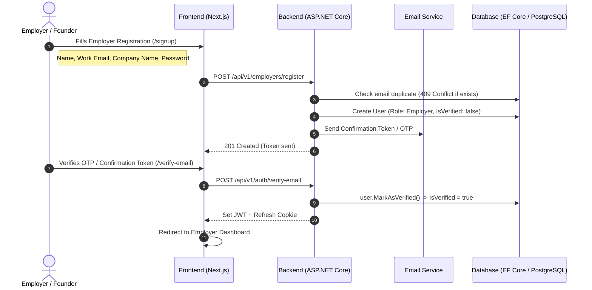
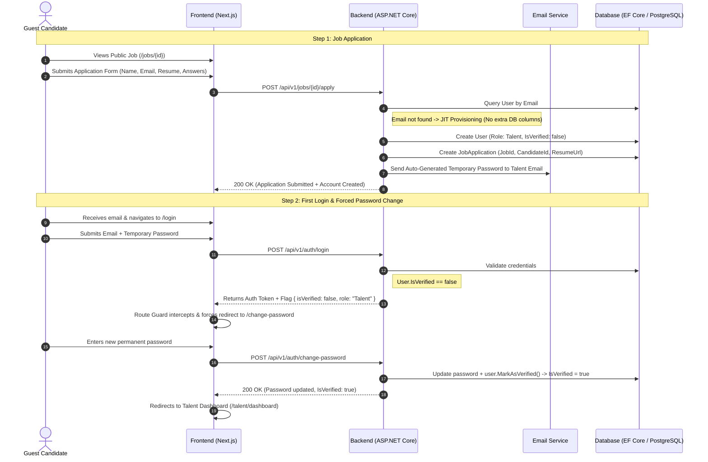
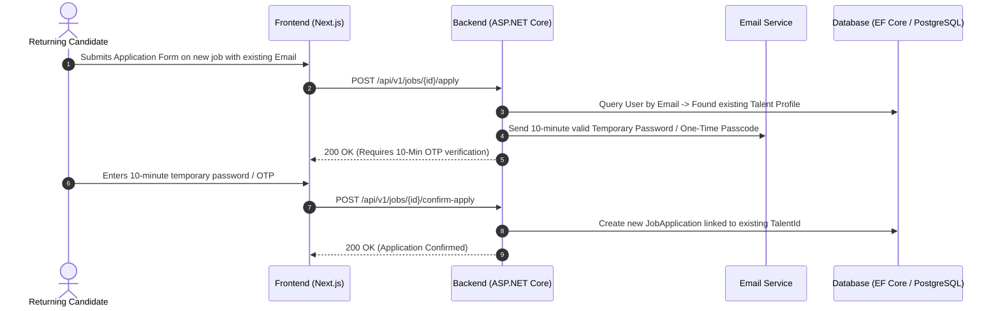

<!-- Last Updated: 2026-08-17 | Auth & User Lifecycle Architecture Specification -->

# TalentX — Authentication & User Lifecycle Specification

This document defines the **authoritative business requirements, sequence flows, and database models** for all user types across TalentX (Employers, Guests, and Talent/Candidates).

---

## 🏛️ 1. Core Principles & Business Requirements

1. **NO Sign Up Page for Talent/Candidates**:
   - There is **NO explicit public registration page** for Talent.
   - The public registration page (`/signup`) is strictly and exclusively for **Employers**.
   - Candidates/Talent browse public job listings (`/jobs`) as guest users.

2. **Just-In-Time (JIT) Talent Account Provisioning**:
   - When a guest candidate applies to a job by filling the application form (providing Name, Email, Resume, etc.), the backend automatically provisions a `User` account.
   - **Database Fields Used (NO Extra DB Columns)**:
     - `Role`: `UserRole.Talent`
     - `IsVerified`: `false`
     - `Email`: candidate's email
     - `Name`: candidate's full name
   - The backend securely generates a temporary password and emails it to the talent.

3. **Talent First Login & Mandatory Password Change**:
   - The talent receives their auto-generated temporary password via email and visits `/login`.
   - Upon successful login with the temporary password, the system detects `IsVerified == false`.
   - The system **strictly forces a redirect to `/change-password`** and blocks dashboard access until the password is updated.
   - Once the talent updates their password:
     - Backend executes `user.MarkAsVerified()` setting `IsVerified = true`.
     - Talent is redirected to the Talent Dashboard and can now view applications, update their profile, and apply to other jobs.

4. **Returning Talent Subsequent Job Applications**:
   - When a candidate applies to another job with their email:
     - Backend checks if the email is already registered.
     - If the email belongs to an existing Talent, backend sends a **10-minute temporary password / OTP** to their email.
     - Candidate confirms their application using the 10-minute code/credentials.

---

## 🔄 2. End-to-End Sequence Diagrams

### Flow A: Employer Registration & Onboarding (Standard Flow)


---

### Flow B: Talent Just-In-Time Provisioning & First-Time Login


---

### Flow C: Returning Talent Subsequent Job Applications


---

## 🗄️ 3. Database Schema Alignment (Zero Extra Columns)

The lifecycle strictly utilizes the existing domain `User` entity properties:

```csharp
public class User : BaseEntity
{
    public string UserId { get; protected set; } = string.Empty;
    public string Name { get; protected set; } = string.Empty;
    public string Email { get; protected set; } = string.Empty;
    public UserRole Role { get; protected set; } // UserRole.Employer | UserRole.Talent | UserRole.Admin
    public bool IsVerified { get; protected set; } = false;

    public void MarkAsVerified()
    {
        IsVerified = true;
        UpdatedAt = DateTime.UtcNow;
    }
}
```

- **`IsVerified == false`**: Indicates unverified email for Employer OR first-time temporary password login for Talent.
- **`IsVerified == true`**: Indicates verified account with active dashboard access.
- **NO new or custom schema migrations required for this lifecycle.**

---

## 🖥️ 4. Frontend UI Alignment Rules

1. **Header Navigation**:
   - `Sign Up` button leads directly to `/signup` (Employer Signup).
   - Candidate navigation options: `Discover Jobs` (`/jobs`) and `Log In` (`/login`).
   - No "Sign Up as Candidate" dropdowns or links anywhere on the platform.

2. **Hero & Split Marketplace Cards**:
   - Candidate Card CTA: `Browse Startup Jobs` (`/jobs`).
   - Employer Card CTA: `Post a Job for Free` (`/signup?role=employer`).

3. **Route Guards & Middleware**:
   - Authenticated Talent with `isVerified: false` are restricted strictly to `/change-password`.
